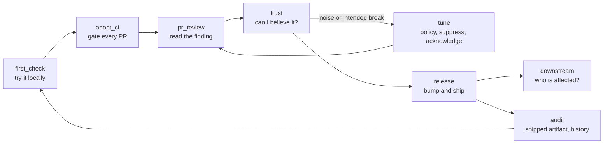

# Customer Journey Map (CJM)

This page maps abicheck's use cases onto the journey a library maintainer goes
through. The [use-case registry](usecase-registry.yaml) says *what* abicheck
supports. This map says *where in the user's work* each case is used, so it
shows which stages are well served, which are thin, and what to build next.

Each registry entry carries `journey_stages: [...]` using the stage keys below.
`tests/test_usecase_registry.py` checks that every entry has a known stage,
that every stage has at least one use case, and that this page defines exactly
the stage keys the test knows. To add a stage, add a `###` heading here and the
key to `_JOURNEY_STAGES` in the test. Status for each use case lives in the
registry, not here; this page names the cases and the gaps.

The registry's `user_task` field (`pr_review | local_check | release | audit`,
from `vision.md`) is coarser and stays as it is. A stage is a step in the
journey; a user task is the reason for the run.

## Persona and priority

**Persona.** A maintainer of a native C/C++ shared library, often with Python
bindings, who ships binaries to consumers they do not control. Secondary
personas: a CI owner who wires the gate, a PR reviewer who reads the comment,
and a downstream integrator who needs to know whether their build still works.
The question at every stage: *"Will this change break someone, and can I
trust the answer?"*

**Current priority.** Linux ELF at L2 (binary plus public headers) is the
primary path. Windows PE, macOS Mach-O and debug-artifact work (PDB, DWP,
dSYM, advanced DWARF) are low priority. A gap on the primary path outranks a
gap on any other platform at the same stage.

## Journey

`trust` sits in the middle on purpose: every later stage depends on the
user believing the verdict. A false-clean result at `trust` is worse than a
noisy one, because nothing downstream will catch it.

## Stage coverage

How many registry use cases serve each stage, by status (counted from
[`usecase-registry.yaml`](usecase-registry.yaml)).

<!-- BEGIN GENERATED: cjm-stage-table -->
<!-- The table in this section is GENERATED by scripts/gen_cjm_stage_table.py from docs/contribute/usecase-registry.yaml — do not edit by hand. Run `python scripts/gen_cjm_stage_table.py` to regenerate. -->

| Stage | complete | partial | modeled | planned | by_design_excluded |
|---|---:|---:|---:|---:|---:|
| `first_check` | 10 | 1 | 0 | 2 | 2 |
| `adopt_ci` | 9 | 0 | 1 | 0 | 1 |
| `pr_review` | 16 | 3 | 0 | 2 | 0 |
| `trust` | 10 | 6 | 1 | 0 | 0 |
| `tune` | 6 | 0 | 0 | 0 | 2 |
| `release` | 9 | 4 | 0 | 0 | 0 |
| `downstream` | 4 | 1 | 0 | 0 | 1 |
| `audit` | 4 | 2 | 0 | 1 | 2 |

<!-- END GENERATED: cjm-stage-table -->

## Stages

### `first_check`

**Goal:** see what changed between two builds, locally, in minutes.
**User question:** "What does abicheck say about my library?"
**Touchpoints:** `abicheck compare old.so new.so`, `dump`, `--depth`, the
quick start, the `explain-abi-change` agent skill.
**Use cases:** UC-WF-compare, UC-PLAT-linux-elf, UC-ARCH-c-library,
UC-ARCH-cpp-library, UC-ARCH-plugin, UC-ARCH-python-api, UC-ARCH-kernel-btf,
UC-ARCH-sycl, UC-PLAT-windows-pe, UC-PLAT-macos-macho, UC-WF-oneshot-deep,
UC-ARCH-header-only, UC-ARCH-cython-api, UC-ARCH-static-lib, UC-WF-mcp.
**Friction:**
- Header-only libraries have no first-class path (G4, G45, vision
  workstream F).
- The one-shot deep compare still needs both sides dumped by hand (G21).
- Static archives are an audit-only operand: `compare --no-baseline LIB.a -H
  include/` reads the archive's symbol index (ADR-086), but two-sided archive
  compare and every other command still reject archives (G8).

### `adopt_ci`

**Goal:** make every PR fail when it breaks ABI, against the right baseline.
**User question:** "How do I wire this into CI without false alarms?"
**Touchpoints:** the GitHub Action, `actions/baseline`,
`actions/check-target`, `project plan`/`validate`, `--dry-run` cost preview,
SARIF/JUnit/JSON output, the `set-up-abi-compatibility-ci` agent skill.
**Use cases:** UC-WF-baseline, UC-WF-cli-contract, UC-WF-policy-profile,
UC-REP-json, UC-REP-sarif, UC-REP-junit, UC-TC-make-auto-query,
UC-TC-build-emitted-facts, UC-REPORTING-dry-run-cost-preview,
UC-TC-bazel-build-evidence, UC-WF-abicc-compat.
**Friction:**
- The Action still encodes some CLI semantics (ADR-070 D1, D2, D4).
- The lifecycle model's P2 is open (ADR-047, G30).
- Bazel build evidence is modeled but not validated (G18).

### `pr_review`

**Goal:** a reviewer understands, from the PR comment, what broke and why.
**User question:** "Is this finding real, and what do I tell the author?"
**Touchpoints:** the PR comment, SARIF annotations, Markdown/HTML report,
`--view root-cause|impact`, `--depth source`, the
`check-abi-compatibility` agent skill.
**Use cases:** UC-CHANGE-taxonomy, UC-WF-compare, UC-REP-sarif,
UC-REP-markdown-html, UC-TC-dual-abi, UC-TC-flag-drift,
UC-TC-modern-cxx-types, UC-TC-cxx-standard-floor, UC-PLAT-linux-elf,
UC-ARCH-c-library, UC-ARCH-cpp-library, UC-ARCH-python-api, UC-ARCH-kernel-btf,
UC-ARCH-sycl, UC-PLAT-windows-pe, UC-PLAT-macos-macho, UC-ARCH-header-only,
UC-ARCH-cython-api, UC-CHANGE-inline-ns-version, UC-TC-numpy-capi-envelope,
UC-WORKFLOW-pr-source-tier.
**Friction:**
- HTML and the PR comment still bucket changes outside `ReportModel`
  (ADR-036 increment 3).
- The PR source tier is partial (G19, ADR-035).

### `trust`

**Goal:** know how far the verdict can be believed: what evidence was used,
what was missing, what the scope was.
**User question:** "Did it really check everything, or is this pass empty?"
**Touchpoints:** the analysis-assurance block, `not_collected`/`FAILED`
facts, comparability refusal, crosscheck, the completeness axis,
`--require-complete-analysis`, `known-gaps.md`.
**Use cases:** UC-WF-analysis-assurance, UC-WF-scope-completeness,
UC-WF-contract-config, UC-PLAT-arch-guard, UC-WF-probe-matrix,
UC-TC-header-scope-robustness, UC-CHANGE-crosscheck-hygiene,
UC-CHANGE-taxonomy, UC-TC-dual-abi, UC-TC-flag-drift,
UC-TC-make-auto-query, UC-TC-build-emitted-facts, UC-WF-oneshot-deep,
UC-WORKFLOW-real-world-corpus, UC-WORKFLOW-pr-source-tier,
UC-TC-bazel-build-evidence, UC-CHANGE-crosscheck-example-corpus.
**Friction (highest priority, L2 Linux first):**
- [A function-pointer parameter's signature is not compared, so a callback
  arity change reads `NO_CHANGE` on the header path](known-gaps.md#a-function-pointer-parameters-signature-is-not-compared-so-a-callback-arity-change-reads-no_change-on-the-header-path-2026-10-15)
  (known gap).
- [castxml reports `NO_CHANGE` for a header-only default template-argument
  change at L2](known-gaps.md#a-header-only-default-template-argument-change-reads-no_change-at-l2-on-castxml-2026-10-21)
  (ADR-085).
- [A large export shrink with no declared surface emits no
  finding](known-gaps.md#a-large-export-shrink-with-no-declared-surface-emits-no-finding-in-header-mode-2026-10-22)
  (known gap).
- [A binary-gate demotion states no coverage gap](known-gaps.md#a-binary-gate-demotion-does-not-state-a-coverage-gap-adr-084)
  (ADR-084).
- No INCONSISTENT/CONFLICTING fact status, and two provider-status
  vocabularies (ADR-063, G47).
- Scope and completeness are partial, and the exit code is still folded by
  two resolvers (ADR-065, G46).
- Real-world validation runs outside CI (G17).
- Low priority: `debug=1` DWARF reads as complete; resolved PDB/DWP/dSYM
  reach no dump path (ADR-021a).

### `tune`

**Goal:** make the gate match the project's real promise: suppress noise,
accept intended breaks, declare the public surface.
**User question:** "This is intended (or not ours). How do I say so without
hiding real breaks?"
**Touchpoints:** `--policy`, `--suppress`, `--contract`,
`--acknowledgments`, `--header`/`--exclude-header`, the disposition audit in
the report.
**Use cases:** UC-WF-suppression, UC-WF-policy-profile,
UC-WF-contract-config, UC-WF-acknowledgment, UC-WF-stable-abi-subset,
UC-TC-header-scope-robustness, UC-WORKFLOW-evidence-directed-scope,
UC-WORKFLOW-focusing-example-corpus.
**Friction:**
- Every disposition must stay visible with its rule and reason (ADR-067);
  the ledger is in place, and new suppression points must join it.
- Contract-source conflicts across multiple inputs are open (vision
  workstream E S3).

### `release`

**Goal:** decide the version bump and ship a release whose ABI promise holds.
**User question:** "What version number does this release need, and is every
artifact consistent?"
**Touchpoints:** release, directory and package compare, the semver
recommendation, bundle facts, wheel checks, Debian symbols, `project
history`.
**Use cases:** UC-CHANGE-semver-recommendation, UC-WF-compare,
UC-WF-debian-symbols, UC-WF-bundle, UC-WF-wheel-vendored,
UC-WF-stable-abi-subset, UC-WF-probe-matrix, UC-TC-glibc-floor,
UC-WF-acknowledgment, UC-WF-scope-completeness, UC-WF-release-history,
UC-CHANGE-inline-ns-version, UC-TC-wheel-deployment-claims.
**Friction:**
- A `kind: bundle` check cannot run at `depth: headers` (ADR-023).
- Versioning policy has no scheme-derived order and no retention (ADR-066,
  G48).
- Wheel deployment claims are partial (G27).

### `downstream`

**Goal:** know which consumers a change affects and whether a given
application or plugin still works.
**User question:** "Which of my users break, and do they need to rebuild?"
**Touchpoints:** `--used-by`, `--used-by-manifest`, `--required-symbol`,
`--use-cases`, `deps tree`/`compare`.
**Use cases:** UC-ARCH-plugin, UC-WF-appcompat, UC-WF-stack-deps,
UC-TC-cxx-standard-floor, UC-TC-numpy-capi-envelope,
UC-ARCH-ffi-consumers.
**Friction:**
- Prebuilt consumers cannot yet be staged and cached in the Action (vision
  workstream D).
- No per-finding `affected_use_cases`, and no runtime-trace ingestion
  (ADR-057).
- An explicit `--lang c++` does not reach the appcompat path (ADR-005).

### `audit`

**Goal:** assess a shipped artifact on its own, or over time.
**User question:** "Is this binary healthy, and how has it evolved?"
**Touchpoints:** `compare --no-baseline`, security-hardening and glibc-floor
checks, the dependency stack, `project history`.
**Use cases:** UC-WF-stack-deps, UC-WF-security-hardening, UC-TC-glibc-floor,
UC-WORKFLOW-single-release-audit, UC-WF-release-history,
UC-WORKFLOW-audit-example-corpus, UC-WF-audit, UC-ARCH-static-lib,
UC-REPORTING-scan-coverage-report.
**Friction:**
- The single-binary audit/lint mode is planned (G11).
- A static archive is audited only as a `compare --no-baseline` operand
  (ADR-086): the declared-vs-defined check runs, but two-sided archive compare
  and the other commands still reject it (G8).

## What to build next

Ordered by journey impact on the primary path (L2, Linux ELF):

1. **`trust`: close the L2 false-clean gaps** (function-pointer parameter
   signatures, castxml template defaults, export shrink without a declared
   surface), then finish ADR-065 S0 and ADR-063's fact-status vocabulary.
2. **`release`: bundle checks at `depth: headers`** (ADR-023).
3. **`first_check`: header-only as a first-class task** (G4, G45).
4. **`adopt_ci`: the Action stops encoding CLI semantics** (ADR-070).
5. **`downstream`: prebuilt consumers in the Action** (workstream D).
6. **Low priority:** Windows/macOS parity and debug-artifact consumption.
